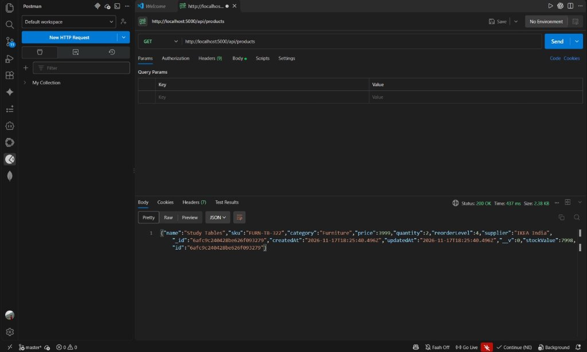
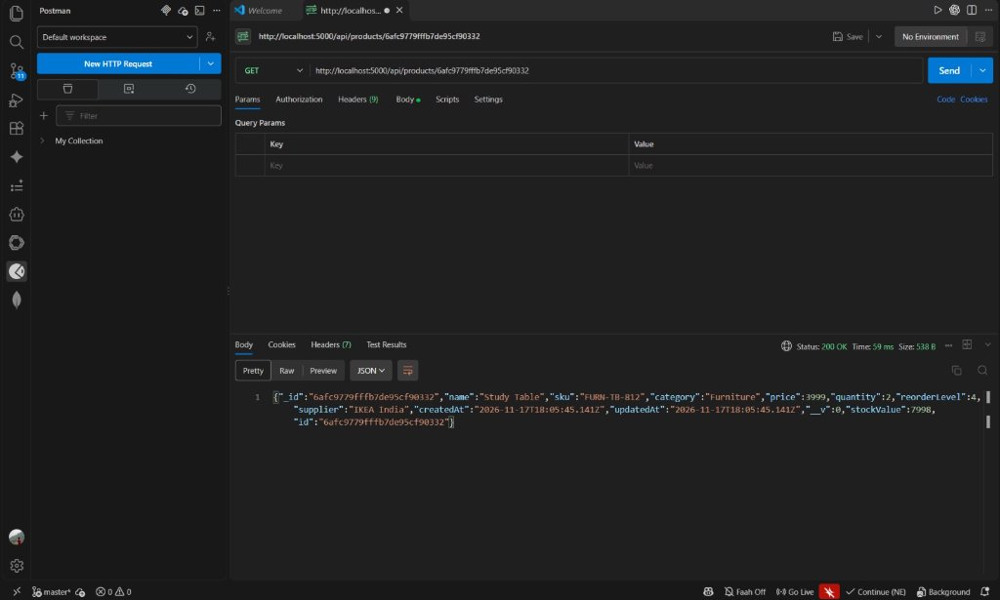
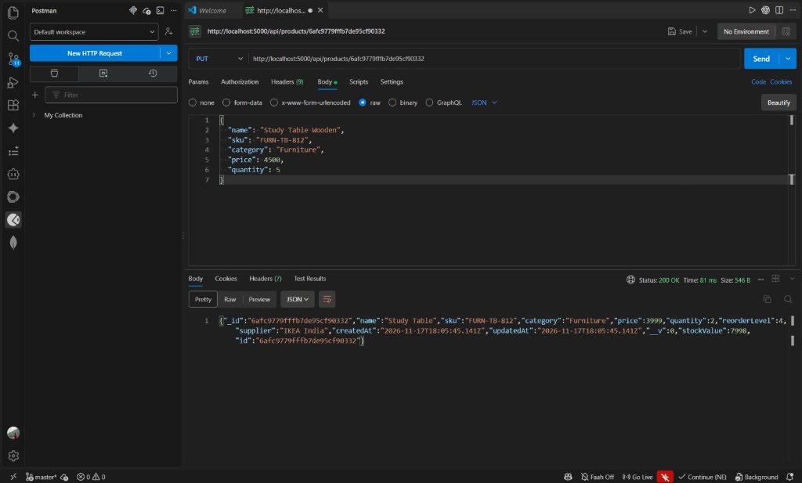
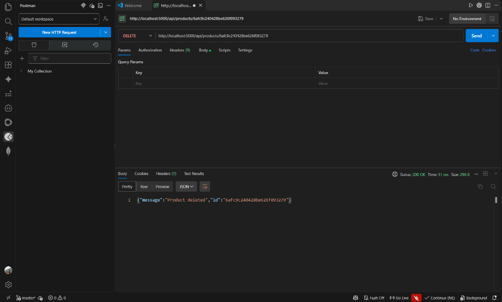
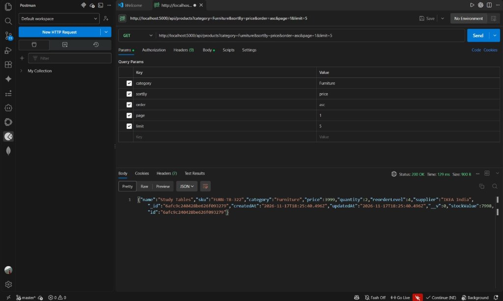

# Inventory and Data Management System
## Web Dev III — Unit 3 | Assignment 3

A robust, RESTful backend for inventory and warehouse management built with **Node.js**, **Express.js**, **MongoDB**, and **Mongoose**.

---

## Features
- **Field-Level Schema Validation**: Comprehensive Mongoose schema validation with non-negative checks, integer validation, trimmed strings, and uppercase unique SKU constraints.
- **Dynamic Stock Value Calculation**: Mongoose virtual property (`stockValue = price * quantity`) computed dynamically without redundant database storage.
- **RESTful CRUD Operations**: Full product lifecycle management with standard HTTP status codes (`200`, `201`, `400`, `404`, `500`).
- **Safe Stock Adjustments**: Atomic stock increments (restock) and decrements (sale) with strict prevention against negative inventory.
- **Advanced Querying**: Query-string based multi-field filtering (`category`, `supplier`, `minPrice`, `maxPrice`, `lowStock`), multi-field ascending/descending sorting, and pagination.
- **Low-Stock Alert Report**: Instant reporting of items where stock quantity is less than or equal to the reorder level.
- **Category-Wise Aggregation**: MongoDB aggregation pipeline grouping inventory by category to compute total items, total quantity, total stock value, and average price.
- **Centralized Error Handling**: Unified Express middleware handling Mongoose `CastError`, `ValidationError`, MongoDB duplicate key (`11000`), and route not found (`404`).

---

## Technology Stack
- **Runtime**: Node.js (v24+)
- **Framework**: Express.js
- **Database**: MongoDB
- **ODM**: Mongoose
- **Configuration**: dotenv

---

## Project Structure
```
web_dev_ass3/
├── config/
│   └── db.js                 # MongoDB connection handler
├── controllers/
│   └── productController.js  # Request handlers for all 8 API features
├── middleware/
│   └── errorMiddleware.js   # Centralized error handler & asyncHandler wrapper
├── models/
│   └── Product.js            # Product Mongoose schema & virtuals
├── routes/
│   └── productRoutes.js      # Express router endpoints
├── screenshots/
│   └── postman/              # Postman test execution screenshots
├── .env                      # Environment configuration
├── .env.example              # Environment template
├── .gitignore                # Ignored files (node_modules, .env, etc.)
├── package.json              # Project dependencies & npm scripts
├── README.md                 # Project documentation
└── server.js                 # Main server entrypoint
```

---

## Getting Started

### 1. Prerequisites
- Node.js installed (v18 or higher recommended)
- MongoDB instance running locally (e.g. `mongodb://127.0.0.1:27017`) or a remote MongoDB Atlas URI

### 2. Installation
Clone the repository and install dependencies:
```bash
npm install
```

### 3. Environment Configuration
Create a `.env` file in the root directory (refer to `.env.example`):
```env
PORT=5000
NODE_ENV=development
MONGO_URI=mongodb://127.0.0.1:27017/inventory_db
```

### 4. Start Server
```bash
npm start
# or for development
npm run dev
```
The server will connect to MongoDB and start on `http://localhost:5000`.

---

## API Reference

### 1. Products
- `POST /api/products` — Create a new product
- `GET /api/products` — Get all products (supports `category`, `supplier`, `minPrice`, `maxPrice`, `lowStock`, `sortBy`, `order`, `page`, `limit`)
- `GET /api/products/:id` — Get single product by ID
- `PUT /api/products/:id` — Update product details
- `DELETE /api/products/:id` — Delete product by ID

### 2. Stock Management
- `PATCH /api/products/:id/stock` — Adjust stock (`{ "change": 10 }` or `{ "change": -5 }`)

### 3. Reports & Analytics
- `GET /api/products/low-stock` — Products where `quantity <= reorderLevel`
- `GET /api/products/summary` — Category-wise aggregation summary

---

## Postman API Testing

### 1. Get All Products

*Demonstrates `GET /api/products` retrieving the catalog with pagination metadata (`total`, `page`, `totalPages`, `count`, `products`) and dynamically computed `stockValue`.*

---

### 2. Get Single Product

*Demonstrates `GET /api/products/:id` fetching product details by its MongoDB ObjectId.*

---

### 3. Update Product

*Demonstrates `PUT /api/products/:id` updating product attributes, automatically refreshing `updatedAt` and recalculating `stockValue`.*

---

### 4. Delete Product

*Demonstrates `DELETE /api/products/:id` removing the product and returning confirmation JSON with the deleted product ID.*

---

### 5. Filtering, Sorting and Pagination

*Demonstrates `GET /api/products?category=Furniture&sortBy=price&order=asc&page=1&limit=5` testing filtering, ascending sort, and paginated responses.*

